<div align="center">

# Kinesis

**Run your day with your mind.**

AI is automating everyone's life except the people who need it most.<br/>
Kinesis gives people who cannot move or speak a way to talk in their own voice, get things done and reach the people they love, using a $350 EEG headset and the tablet or phone they already own.

<br/>

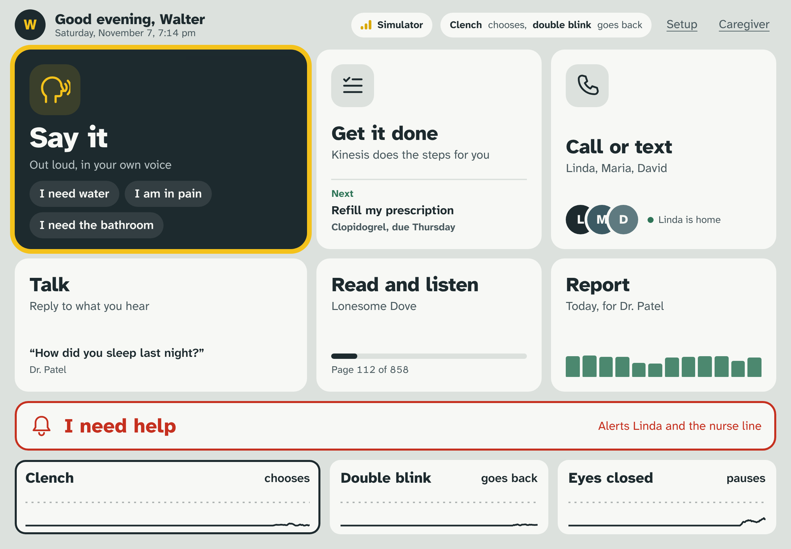

<br/>

| 3 | 95% | 94% | 5 min |
|:---:|:---:|:---:|:---:|
| public labeled EEG datasets,<br/>60 people, our models built and scored on them | look-to-choose accuracy in 2 s<br/>(Tsinghua benchmark, 35 people) | seizure recordings flagged<br/>(Bonn epilepsy dataset) | setup: contact check<br/>and a 1-minute calibration |

</div>

---

## Contents

- [What it does](#what-it-does)
- [Who it is for](#who-it-is-for)
- [How it works](#how-it-works)
- [Technical deep dive](#technical-deep-dive)
- [Datasets](#datasets)
- [Validation](#validation)
- [Screens](#screens)
- [Quick start](#quick-start)
- [Repository layout](#repository-layout)
- [Tech stack](#tech-stack)
- [Privacy and safety](#privacy-and-safety)
- [Credits](#credits)

## What it does

A person wears a light headset with six dry electrodes. A yellow frame steps through the choices on screen. A jaw clench chooses, a double blink goes back, and looking at a flashing square picks it directly. Three things a day runs on are one or two choices away:

| | Moment | What happens |
|---|---|---|
| 1 | **Say it** | "I need water" is spoken out loud in the person's own voice, cloned with ElevenLabs. |
| 2 | **Get it done** | "Refill my prescription": an agent shows its plan, waits for one confirming choice, calls the pharmacy and texts his wife to pick it up. |
| 3 | **Call or text** | Pick a person, call them, or send "Can you come here?". It shows up live on the caregiver page, and as a real text once sending is switched on. |

Around those three, Kinesis keeps watch:

- **Talk.** It hears what someone in the room says and offers four likely replies. One choice speaks the reply.
- **Safety monitor.** It flags seizure-like activity and alerts the care list. It also flags a sustained change in brain rhythm, logged for the doctor.
- **Doctor report.** A daily summary the person chooses to send: choices made, calls, messages, brain events, signal quality by hour, and their own notes.
- **Help.** "I need help" sits at the bottom of every screen and alerts the care list in one choice.

## Who it is for

People with motor and speech impairment: stroke, ALS, cerebral palsy, spinal cord injury, MS, muscular dystrophy. Many of them are older, and many have no reliable way to use a phone at all.

Our reference user is **Walter, 72**. A stroke 18 months ago took most of his speech and the use of his right side. He lives with his wife Linda in Raleigh. Every screen, phrase and contact in the demo is built for him: large type, Atkinson Hyperlegible, high contrast, a picture with every phrase, one input at a time, and a scan speed set for him.

- **Hardware:** one NeuroPawn Knight headset (about $350) plus a tablet, phone or laptop the person already has. Target total under $450.
- **Setup:** about 5 minutes. A contact check, then a one-minute calibration that learns this person's own clench and double blink.
- **No smart home needed:** everything happens through the person's own voice, phone and apps.

## How it works

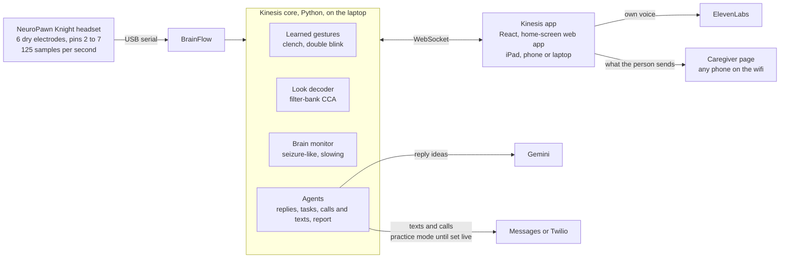

**One input at a time.** The app is a scanning board. The person never needs fine control, only one deliberate signal to choose and one to go back.

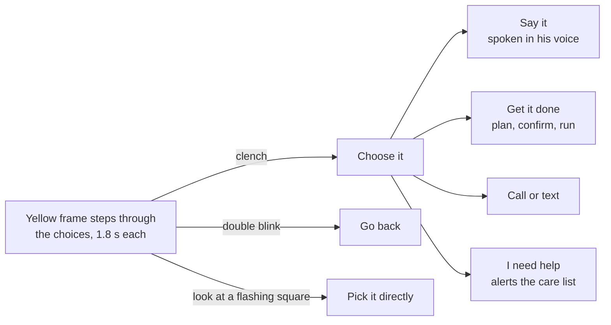

**Calibrated to the person, not to an average.** Fixed thresholds missed every double blink on our headset, so each person trains a small model in one minute. It starts from our own labelled recordings.

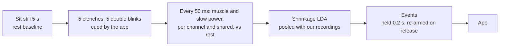

## Technical deep dive

### Signal chain

| Stage | Detail | Code |
|---|---|---|
| Board | NeuroPawn Knight (BrainFlow board 57), 125 samples per second, gain 12 | `kinesis/board/knight.py` |
| Electrodes | 6 dry spikes on pins 2 to 7: Oz, O1, O2, POz (back of head), Fp1 (forehead), T7 (temple). Ear clip into RLD and COMM. Our recordings showed pins 1 and 8 empty, so the pin map lives in one file. | `kinesis/montage.py` |
| Enable sequence | Start stream with a 450,000-sample buffer, wait 2 s, then per channel: wait 0.5 s, `chon_N_12`, wait 1 s, `rldadd_N`, wait 0.5 s. Commands sent faster than this are dropped. | `Knight.start()` |
| Core loop | Every 50 ms: read the last 2 s, run the detectors on the last 1.2 s, stream levels to the app. Contact check every 1 s. Brain monitor every 2 s on 4 s windows, in a worker thread. Look decoder every 0.25 s while the Look screen is open. | `kinesis/server.py` |
| Contact check | Relative to the other channels, so it works in any units. Flat if spread under 0.5. Floating if the 1 to 40 Hz spread is over 10 times the quieter channels. Noise if 45 to 60 Hz power is over 0.6 of the signal. | `kinesis/signal/live.py` |
| Recording | Every session is written to `data/sessions/` in BrainFlow format, with cue markers. | `scripts/record*.py` |

### Learned gestures (clench and double blink)

- **Features.** For each channel:
  - muscle power (20 to 55 Hz) and slow power (0.5 to 8 Hz),
  - each on the raw channel and on the channel minus the median of all channels,
  - plus the same two powers of the shared median.
  
  That is 4 per channel plus 2 shared, 22 features with 5 channels. All are log ratios to the person's rest, on the last 0.5 s.
- **Why those features.** On our headset a clench is a burst every channel shares, because the ear clip sits next to the jaw muscle. A double blink is one channel, the forehead, with two spikes about 0.2 s apart. Shared versus local power separates them.
- **Model.** Shrinkage linear discriminant analysis, written in NumPy:
  - standardized features,
  - pooled covariance shrunk 20% toward a scaled identity,
  - softmax over the class scores (rest, clench, double blink).
- **Labels from calibration.**
  - A frame inside a cued step, with median muscle power at least 4 times rest, gets that gesture's label.
  - A frame under 2 times rest is rest.
  - The person's frames are weighted 3 times and pooled with our five labelled trials whenever they share 3 or more channels.
  - Training takes under a second. Pooling never did worse than calibration alone, and it rescued the sessions where calibration alone broke.
- **Events.** The top gesture must reach probability 0.8, with activity at least 2 times rest, held for 0.2 s.
  - Clench re-arms only after rest, so a held clench never selects twice.
  - Double blink also re-arms when activity falls below 45% of its peak, because people do them back to back.
  - Refractory periods: 0.8 s for clench, 0.7 s for double blink.

Code: `kinesis/signal/learned.py`, trained and tested with `scripts/train_gestures.py`.

### Look to choose (SSVEP)

| Parameter | Value |
|---|---|
| Tile rates | 8.57, 10, 12, 15 Hz: a 60 Hz display divided by 7, 6, 5 and 4 frames, so the browser draws them exactly |
| Method | Filter-bank canonical correlation analysis against sine and cosine references, 3 harmonics. No training. |
| Sub-bands | 6 to 60, 14 to 60, 22 to 60 Hz, weighted (m+1)^-1.25 + 0.25 |
| Channels and window | Oz, O1, O2, POz, the last 2 s |
| Live decision | Same winner on 3 updates in a row (every 0.25 s), with (best minus second) / best at least 0.45, then a 1.5 s refractory |

Tuned on benchmark people 1 to 10 and on 100 s of our own headset with nothing flashing, then checked on all 35. Code: `kinesis/signal/ssvep.py`, `scripts/validate_ssvep.py`.

### Brain monitor

- **Features per 4 s window** (`kinesis/agent/brain.py`):
  - line length and RMS, as ratios to the person's own rest,
  - rhythmicity, peak frequency and muscle ratio,
  - delta/alpha ratio and band powers.
- **Seizure-like rule.** A window counts when:
  - line length is at least 3.5 times rest and RMS at least 1.8 times, or RMS at least 4 times and line length at least 2 times,
  - and rhythmicity is at least 0.035,
  - and muscle ratio is at most 0.6, so a clench is not a seizure.
  
  It must hold on at least 2 of Oz, O1, O2, POz, T7 (channels flagged as bad are skipped), for 4 windows in a row, which is about 10 s. Then the care list is alerted and the episode is logged. It ends after 3 quiet windows.
- **Slowing.** The minute's delta/alpha ratio is above 2 times baseline, or the O1/O2 brain symmetry index is above baseline plus 0.15, for 5 minutes in a row. That gives a notice to the person and a line in the doctor report. It only alerts others if turned on in the profile.

Code: `kinesis/agent/monitor.py`, validated with `scripts/validate_seizure.py`.

### Words (research)

- **Pipeline** (`kinesis/signal/words.py`):
  - Riemannian tangent space of OAS covariance matrices plus logistic regression,
  - and log band power in 5 bands plus shrinkage LDA.
- **Scoring:**
  - stratified cross-validation grouped by trial, so pieces of one trial never sit on both sides of a split,
  - a permutation test that shuffles whole-trial labels and redraws balanced splits each time.
- **Checks:** on test data, it finds a real difference (p 0.02) and reports none on pure noise.

### Agents

- **Fixed action registry.** The agent can only use these actions: speak, message, call, help, alert, media, report.
- **Plans before actions.** A task shows its full plan and runs only after the person chooses **Go ahead**. Finished steps are shown live.
- **Practice mode by default.** Every send is written to `data/logs/outbox.jsonl` and nothing leaves the laptop until `KINESIS_LIVE=1`. Live backends: Messages on a Mac, or Twilio.
- **Replies.** Gemini writes four short first-person replies with different intents. Without a key, canned replies by question type.

Code: `kinesis/agent/`.

### Latency budget

| Step | Time |
|---|---|
| Core loop period | 50 ms |
| Gesture feature window | 0.5 s, decision held 0.2 s |
| Look decision | median 2.2 s to choose (benchmark, streamed live) |
| Scan step | 1.8 s per choice |

### App and protocol

- React 19 and Vite 7, with no UI library.
- The dev server does four jobs. It voices phrases through ElevenLabs and caches them on disk, gets reply ideas from Gemini, feeds the caregiver page live, and forwards `/core` to the core. That way an iPad reaches the headset through one address.
- WebSocket messages (`docs/PROTOCOL.md`):
  - core to app: `hello`, `levels`, `event`, `quality`, `calibration`, `replies`, `plan`, `step`, `alert`, `notice`, `report`
  - app to core: `action`, `confirm`, `cancel`, `calibrate`, `look`, `heard`, `report_request`, `demo_seizure`

## Datasets

**Primary data: public, labeled EEG datasets.** The decoders are built and scored on these, with only the channels and sample rate our headset has. Download and labels: `python scripts/get_datasets.py` and [docs/DATASETS.md](docs/DATASETS.md).

| Dataset | People | What is labeled | Size | We use it for |
|---|---|---|---|---|
| [Tsinghua SSVEP benchmark](http://bci.med.tsinghua.edu.cn/download.html) (Wang et al. 2017) | 35 | Which of 40 flashing targets (8 to 15.8 Hz) the person looked at, 6 blocks each | 64 ch, 250 Hz, 8,400 trials | Look to choose: decoder design, tuning and validation |
| [2020 BCI Competition track 3](https://nemar.org/dataset/nm000113) (imagined speech, NEMAR nm000113) | 15 | Which of 5 phrases was imagined: Hello, Help me, Stop, Thank you, Yes | 64 ch, 256 Hz, 6,000 trials | Words pipeline: training and held-out scoring, 64 channels vs our 6 |
| [Bonn epilepsy dataset](https://www.ukbonn.de/epileptologie/arbeitsgruppen/ag-lehnertz-neurophysik/downloads/) (Andrzejak et al. 2001) | 10 | Healthy eyes open, healthy eyes closed, interictal (2 sites), seizure | 500 single-channel recordings, 23.6 s each | Brain monitor: seizure-like rule and its false-alarm rate |

**Baseline data: our own headset.** Short recordings to check contact, set each person's rest level and seed the gesture model, since no public dataset has jaw clenches and double blinks on this board.

| Recording | What | Use |
|---|---|---|
| `kinesis/data/baseline/` | 3 trials: eyes open and closed, jaw clenches | Contact check and rest baseline |
| `kinesis/data/gestures/` | 5 trials: clenches and double blinks, sections marked | Seed for the per-person gesture model |
| `kinesis/data/words/` | 18 imagined yes/no trials | Checks the words result on our own headset |

## Validation

Every number comes from a script in this repo. Full write-up: [docs/VALIDATION.md](docs/VALIDATION.md).

<p align="center">
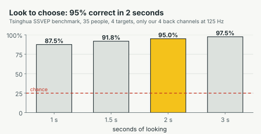
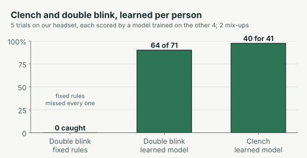
</p>
<p align="center">
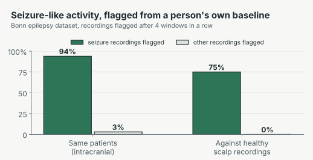
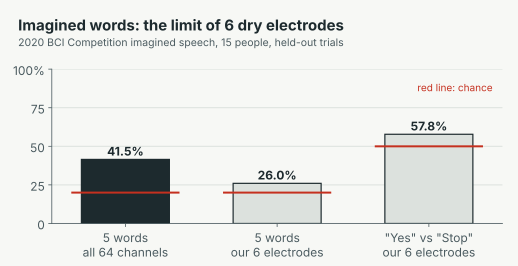
</p>

| What | Data | Result |
|---|---|---|
| Look to choose | **Public:** Tsinghua SSVEP benchmark, 35 people, 4 targets, our 4 channels at 125 Hz | 95.0% at 2 s (87.5% at 1 s, 97.5% at 3 s). Live decoder: first choice right 93.1%, wrong 0.2%, median 2.2 s |
| False looks | **Baseline:** our headset, 100 s with nothing flashing | 1 false choice |
| Double blink | **Baseline:** our headset, 5 trials, each scored by a model trained on the other 4 | 64 of 71 caught, none read as a clench. Fixed rules caught 0 |
| Clench | Same | 31 of 41 caught, 1 read as a double blink. 2 false events in 145 s still |
| Seizure-like | **Public:** Bonn epilepsy dataset, 500 labeled recordings | 94% of seizure recordings flagged, 3% of non-seizure (same patients); 75% and 0% against healthy scalp recordings |
| Imagined words | **Public:** 2020 BCI Competition track 3, 15 people | 41.5% on 5 words with 64 channels (chance 20%, all 15 above chance); 26.0% with our 6 electrodes |
| Imagined yes/no | **Baseline:** our headset, 18 trials | No difference between words (chance) |

**Limits we report plainly:**

- The SSVEP benchmark used gel electrodes in a lab. Our dry back-of-head electrodes need good contact first.
- Eyes-closed alpha did not show reliably on our current fit.
- Imagined speech is near chance with 6 dry electrodes. That is why yes/no runs on the Look tiles or a clench today, and the speech pipeline waits for denser headsets.
- The seizure rule was tuned on the same dataset it was tested on, so expect lower on new people.
- Kinesis flags patterns for a doctor to review. It does not diagnose.

## Screens

<table>
<tr>
<td width="50%">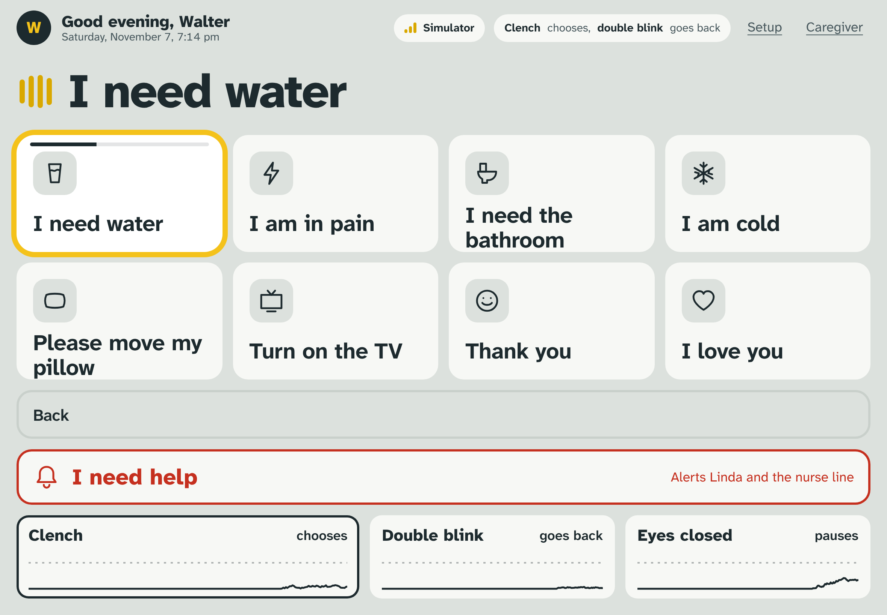<br/><b>Say it.</b> One choice, spoken in his own voice.</td>
<td width="50%">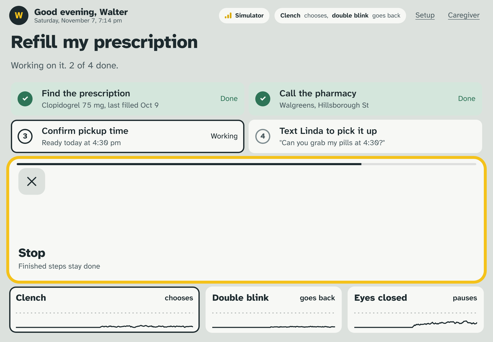<br/><b>Get it done.</b> The agent's plan, confirmed, running step by step.</td>
</tr>
<tr>
<td width="50%">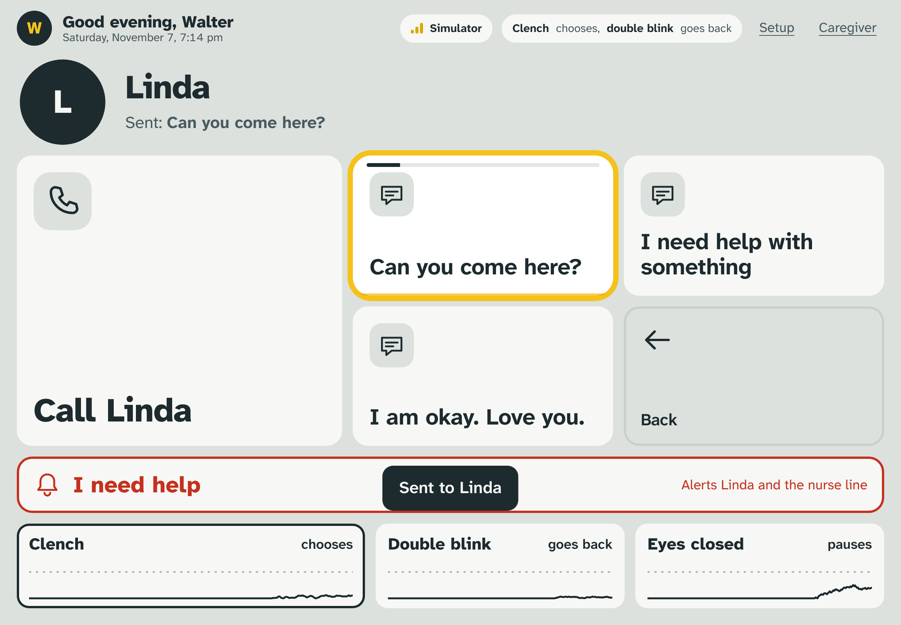<br/><b>Call or text.</b> Call Linda, or send a quick text.</td>
<td width="50%" align="center">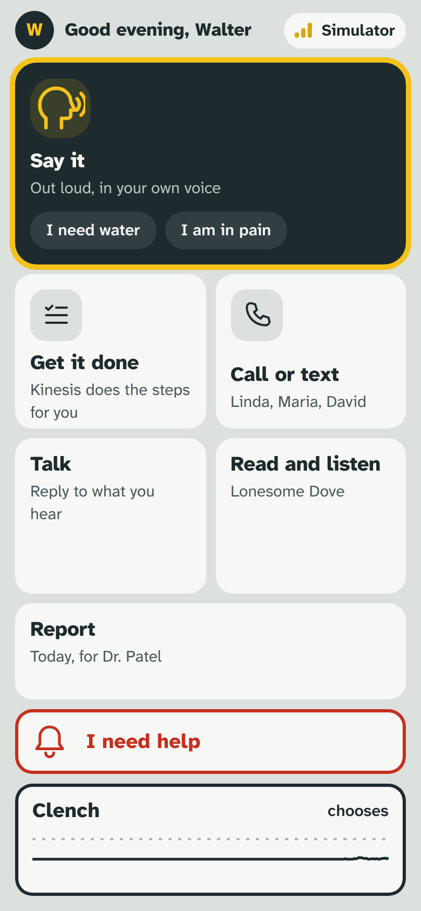<br/><b>Phone.</b> The same app, added to the home screen.</td>
</tr>
</table>

## Quick start

```bash
git clone https://github.com/RehanMohammed985/Kinesis.git && cd Kinesis
pip install -r requirements.txt
cd app && npm install && cd ..
python scripts/get_datasets.py              # the public labeled datasets, into data/external/
python -m kinesis.server --synthetic        # or --port <serial port> with the headset
cd app && npm run dev                       # open http://localhost:5173
```

Full setup, the headset, the iPad and the demo script: **[docs/SETUP.md](docs/SETUP.md)**.

## Repository layout

```
kinesis/
  server.py        the core: reads the headset, runs detectors and agents, talks to the app
  montage.py       which board pin each electrode is on
  board/           NeuroPawn Knight wrapper over BrainFlow, synthetic board for development
  signal/          learned.py (clench, double blink), ssvep.py (look), live.py (rules, contact check), words.py
  agent/           action registry, replies, tasks, calls and texts, brain monitor, doctor report
  stimulus/        cued yes/no recording task
  data/            our labelled recordings and trained models (baseline, gestures, words)
app/               React app and its dev server (voice, replies, caregiver feed, /core forwarding)
scripts/           record, train, validate (SSVEP, seizure, speech), voice setup, README charts
tests/             agent checks on simulated signals
docs/              SETUP, VALIDATION, HARDWARE, PROTOCOL, DESIGN, PLAN
```

## Tech stack

| Layer | Tools |
|---|---|
| Hardware | NeuroPawn Knight EEG board, 6 dry electrodes, ear clip reference |
| Acquisition | BrainFlow |
| Signal processing and models | NumPy, SciPy, scikit-learn, pyRiemann |
| Core | Python 3.11, asyncio, websockets |
| App | React 19, Vite 7, Atkinson Hyperlegible Next, home-screen web app |
| Voice and language | ElevenLabs (eleven_flash_v2_5), Gemini (gemini-2.5-flash) |
| Sending | Messages on macOS, or Twilio |

## Privacy and safety

- **Practice mode by default.** Nothing is sent unless `KINESIS_LIVE=1` is set. Until then every text and call is written to a local log.
- **Only what the person chooses leaves.** Messages they pick, reports they approve, help they ask for. Never raw EEG, never inferred mental state.
- **Data stays local.** Recordings, logs, reports and the person's profile with phone numbers live in `data/`, which is kept out of git.
- **Every send is a deliberate choice.** Texts, calls and help go out only when the person chooses them. Agent plans show every step first and wait for **Go ahead**. The one exception is the seizure-like alert, which the person (or their proxy) switches on in their profile.
- **Not a medical device.** Brain events are flagged for a doctor to review, not diagnosed.

## Credits

Built at the BR41N.IO Brain-Computer Interface Hackathon at NC State, November 2026, NeuroPawn track, by Rehan Mohammed, Kennedy Brundidge and team.

Data and tools we stand on:
- Tsinghua SSVEP benchmark (Wang et al., IEEE TNSRE 2017).
- 2020 BCI Competition track 3, BIDS release on NEMAR (nm000113).
- Bonn epilepsy dataset (Andrzejak et al., 2001).
- BrainFlow, and NeuroPawn's Knight board and SSVEP examples.

License: not chosen yet. Contact the team before reuse.
